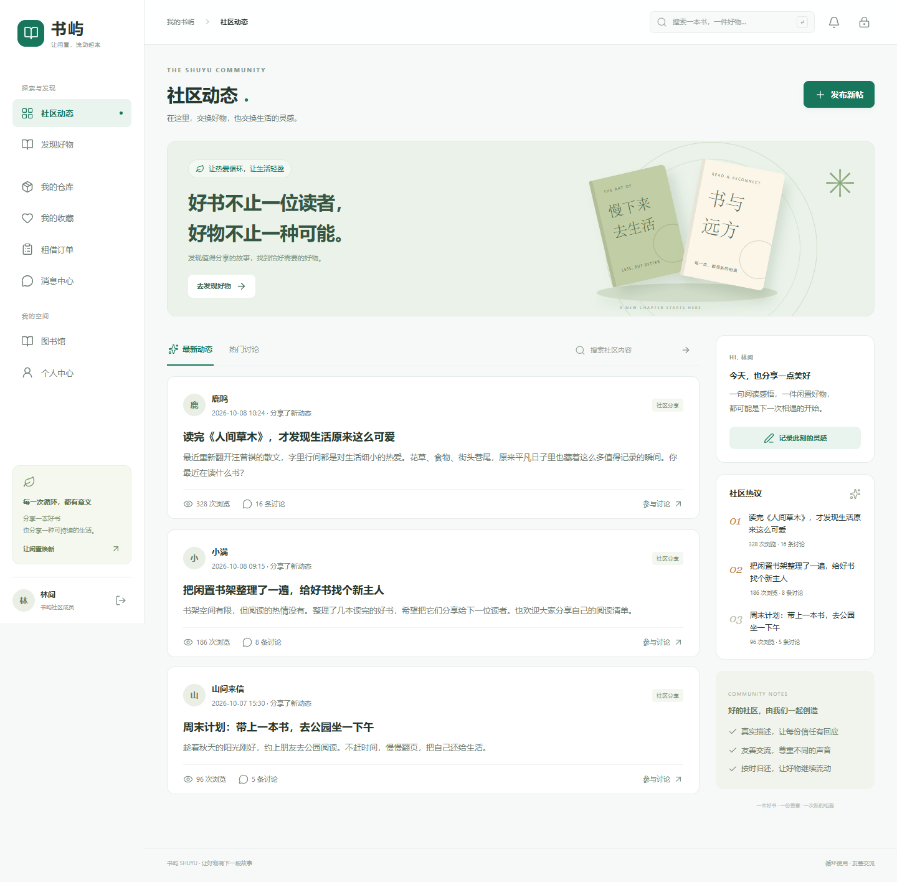
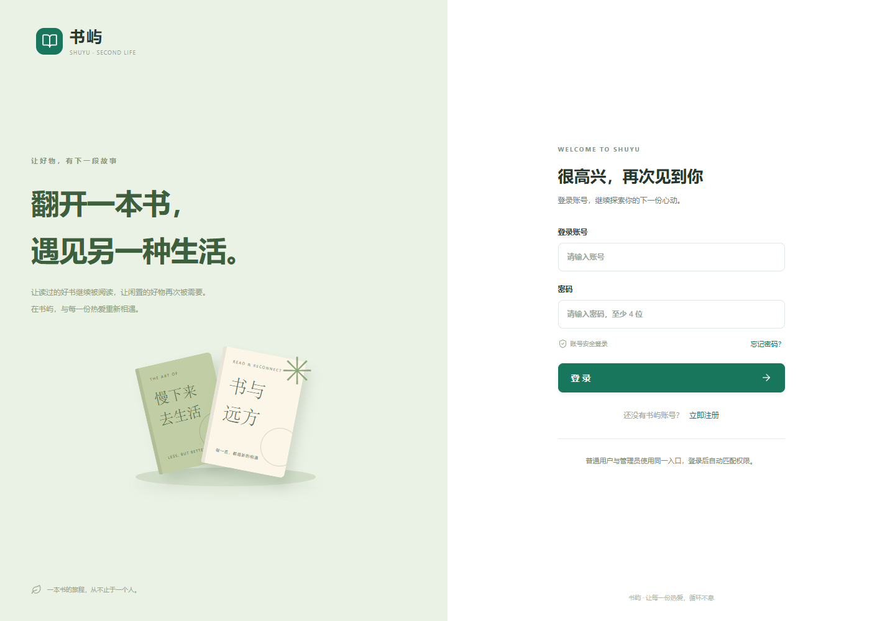
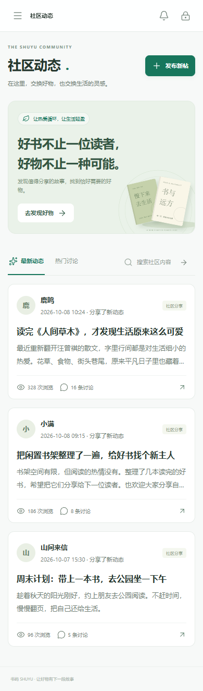

# Vue 迁移与界面改版验收记录

日期：2026-10-08。

## 交付范围

原来的 React 入口、JSX 页面与 React 依赖已退出当前应用，替换为 Vue 3 单文件组件和 Vue Router。React 原版保存在 `react-backup-20261008`，不参与新版构建。

视觉采用“集物志 · 闲置交易与兴趣社区”：绿色主色、米白与浅灰背景、统一留白和卡片、线性图标、桌面侧栏和移动抽屉导航。首页以内容社区为主入口，闲置市集和书籍专区作为并列业务模块；装饰插图使用 CSS 绘制，不依赖外部图片或字体网络服务。

订单申请与支付拆成可重试的两个步骤。创建申请后进入订单页，即使模拟支付失败也不需要重复创建申请。原后端的权限和业务状态机保持不变。

## 构建测量

同一电脑、同一项目，均使用 `npm run build`。单位为十进制 KB，Gzip 数值来自 Vite 的构建报告。

| 指标 | React 原版 | Vue 改版 |
| --- | ---: | ---: |
| 主 JavaScript（原版全量入口 / 新版入口加 Vue 运行库） | 730.47 KB | 142.36 KB |
| 登录首屏 JavaScript（计入登录页面） | 730.47 KB | 148.71 KB |
| 登录首屏 JavaScript 的 Gzip 估算 | 235.42 KB | 56.68 KB |
| 全局 CSS | 68.33 KB | 40.70 KB |
| 全局 CSS 的 Gzip 估算 | 13.00 KB | 9.87 KB |
| Excel 解析库 | 混入入口 | 429.03 KB，选择导入文件时加载 |

登录首屏 JavaScript 的未压缩体积约减少 **79.6%**，Gzip 估算约减少 **75.9%**。这说明下载及解析负担减少，不等同于真实用户首屏时间提升相同比例。没有对真实数据库进行延迟、吞吐或高并发测试。

## 验证

- 生产构建通过；前端 ESLint 检查通过。
- 请求层 7 项 Node 测试通过：URL 前缀、并发去重、缓存副本、账号隔离、修改后缓存失效、旧读取不能污染缓存、取消 / 超时和会话过期等。
- 浏览器 17 项测试通过，使用本机 Edge 和生产构建，覆盖登录及返回原地址、所有用户页面、管理员拦截、搜索分类分页、缓存返回、仓库发布、弹窗焦点、支付失败重试、租借流转、买断退款、资料保存、私信发送撤回、管理列表、故障重试、注册找回密码、发帖留言、图书归还、图片上传、按需导入及过期搜索响应隔离。
- 检查 1440px 桌面与 390px 手机布局；主要页面未出现横向溢出。截图经过人工查看，并调整了手机插图位置和次要文字对比度。
- 后端入口及数据库配置通过 Node 语法检查。

浏览器测试的接口响应来自 `tests/e2e/fixtures.js`，并非真实用户数据。测试数据只存在于测试环境，未添加到生产页面或数据库。

## 尚未完成的真实环境验证

当前电脑的 `MySQL80` 服务停止；启动服务时返回权限错误。数据库连接检查返回 `ECONNREFUSED`，因此**真实数据库登录、上传、订单写入、归还和退款尚未完成端到端联调**。请由有权限的用户启动 MySQL，再执行 `npm run dev:all` 验证。

迁移未执行数据库初始化、重建、清空或测试数据灌入。数据库模式沿用原项目，原有后端数据上限也保留：广场最多返回 300 条、社区最多返回 200 条、单个会话最多返回 500 条。当前列表采用前端分页减少渲染量；超出上述规模时仍需另做服务端分页和数据库性能测试。

此次依赖安装仍报告既有依赖漏洞；没有通过强制升级改动后端及 Excel 文件兼容性。此次交付不代表生产级安全审计、支付接入或容量验收完成。

## 界面效果

以下截图展示迁移后的真实 Vue 页面，内容使用隔离的演示数据。

### 桌面社区

### 登录页

### 手机社区

好物广场截图见 `docs/previews/plaza-desktop.png`。
